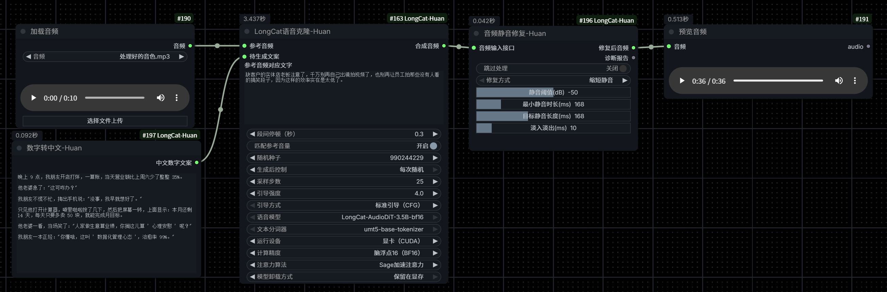

# LongCat-Huan

独立的 ComfyUI 语音克隆插件，使用 ComfyUI 默认节点界面。

## 工作流预览



[下载示例工作流](example_workflows/LongCat-Huan-语音克隆.json)

| 显示名称 | 节点类型 ID | 用途 |
| --- | --- | --- |
| LongCat语音克隆-Huan | `LongCatVoiceClone-Huan` | 参考音色克隆、长文本分段、响度匹配、模型缓存与卸载 |
| 数字转中文-Huan | `SmartText-Huan` | 数字、日期、时间、比例、单位等中文朗读文本输出 |
| 音频静音修复-Huan | `AudioSilenceRepair-Huan` | 静音检测、缩短／删除静音和诊断报告 |

节点分类统一为 `LongCat-Huan`。只注册以上三个节点，全部使用原生 ComfyUI 控件、颜色和布局。前端代码提供中文标签、参数排序和文本框布局。节点 ID 独立，可以与原插件共存。

2026-10-16：文本框改名为“数字转中文-Huan”，参数、端口、开关和下拉选项统一中文显示。模型名称和 CUDA、BF16、CFG 等技术标识保留，以便选择正确的模型与运行方式。旧工作流的英文参数键和选项值仍可使用。

## 安装与使用

1. 将整个 `LongCat-Huan` 文件夹放到 `ComfyUI/custom_nodes/`。
2. 使用运行 ComfyUI 的 Python 环境安装 `requirements.txt` 中缺少的依赖。已经能运行原工作流的当前环境无需重新安装。
3. 重启 ComfyUI，刷新浏览器；搜索 `Huan` 或打开 `LongCat-Huan` 分类。
4. 导入 `example_workflows/LongCat-Huan-语音克隆.json`。

配套工作流已移除变速节点，静音修复后的音频直接送入预览节点；原文案、参考音频和克隆推理参数保留。

参考音频是 ComfyUI `input` 下的 `处理好的音色.mp3`。换用其他参考音频时，需要在“加载音频”节点重新选择文件，并让 `prompt_text` 对应参考音频实际说话内容。“数字转中文-Huan”仅输出“中文数字文案”，连接到克隆节点。静音修复仅接受音频连线，已移除路径输入框。

## 模型和依赖

插件内包含 AudioDiT 模型实现、离线加载器和所需音频模块，不导入 `ComfyUI-xiaozhuguang` 或 `huanhuan-yinpinxiufu`。

模型权重和分词器继续使用 ComfyUI 的公共模型目录，不随插件重复打包：

```text
ComfyUI/models/audiodit/
├── LongCat-AudioDiT-3.5B-bf16/
│   ├── config.json
│   └── model.safetensors
└── umt5-base-tokenizer/
    ├── tokenizer_config.json
    └── spiece.model 或 tokenizer.json
```

本地扫描和模型加载均为离线模式。`sage_attention` 和 `flash_attention` 需要相应可选加速库；`sdpa` 使用 PyTorch。可通过环境变量 `LONGCAT_HUAN_DISABLE=1` 停止该插件的 LongCat 推理功能。

## 本次独立化修正

- 长句的时长估算不再先截断到上限，使逗号切分和无标点硬切能够真正执行。
- 克隆异常或中断后清理“生成中”标志，并按选择的策略处理模型缓存。
- 音频处理失败时向 ComfyUI 抛出明确错误，避免把一段空音频当作成功结果。
- 模型与分词器路径限制在模型目录内；模型实现不覆盖 Transformers 全局的 AudioDiT 注册。

静音修复节点已移除“移除数字误差”和“高级模式”，只执行普通静音缩短或删除；缩短静音使用指定目标长度。变速节点及其专用实现已移除。此次按测试阶段要求更新接口，不兼容旧版节点的参数数组和输出编号，请使用新版工作流或重新添加节点。

## 代码位置

```text
__init__.py                       三个节点注册
nodes/longcat.py                  克隆节点、分段和响度保护
nodes/offline_loader.py           本地模型与分词器选择
nodes/model_loader.py            权重、精度和注意力实现
nodes/model_cache.py             缓存、卸载与 CPU 转移
nodes/text.py                    文本和数字转换
nodes/audio_diagnostic_repair.py  静音修复节点
nodes/audio_*.py                  音频输入与修复实现
nodes/silence_detector.py         静音与数字误差检测
audiodit/                        模型结构与推理实现
tests/test_nodes.py              功能回归测试
```

## 验证

### 参数排序（2026-10-16）

LongCat 所有参数始终展开，不再提供高级设置折叠开关。显示顺序为：文案和参考文字 → 段间停顿、匹配参考音量 → 随机种子、生成后控制 → 采样步数、引导强度、引导方式 → 模型、分词器、设备、精度、注意力算法、卸载方式。参考文字框保留明确标题和原生编辑控件。已连接的待生成文案显示为输入接口；未连接时仍可在节点直接输入文案。显示顺序调整不会改变旧工作流的参数数组顺序或推理值。

更新插件后重启 ComfyUI 并刷新页面，导入新版配套工作流。


待生成文案采用带标题的大文本框，最小控件高度 260 像素（画布缩放前），参考文字框最小高度 140 像素。连接外部文案节点时，待生成文案仍按 ComfyUI 的接口方式显示。

测试环境、运行结果和测试范围见 `TEST_REPORT.md`。在安装目录下运行：

```powershell
& '<ComfyUI使用的Python路径>' -X utf8 -s .\tests\test_nodes.py
```

在其他位置运行测试时，用 `COMFYUI_ROOT` 指定 ComfyUI 根目录。当前验收测试使用已有的 BF16 模型、UMT5 分词器和 `input/处理好的音色.mp3`。

